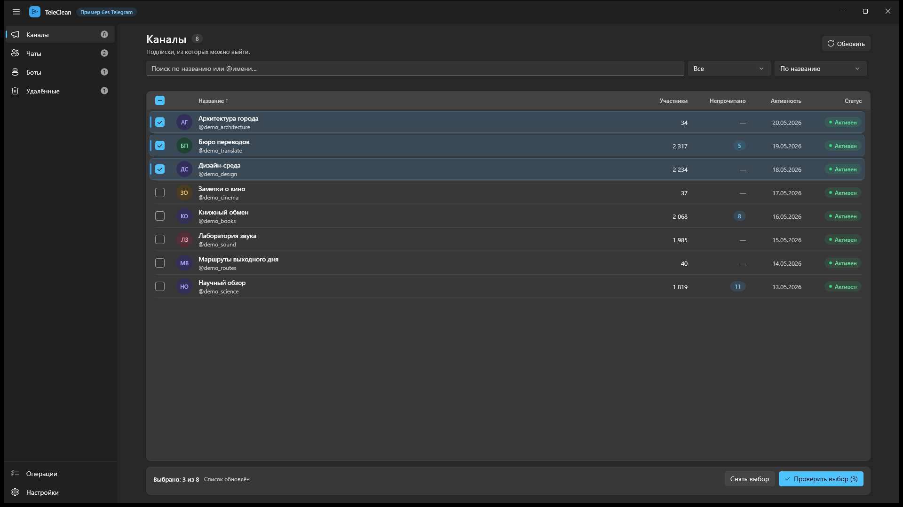
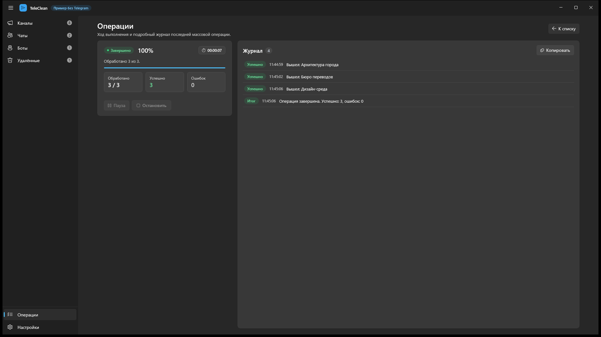
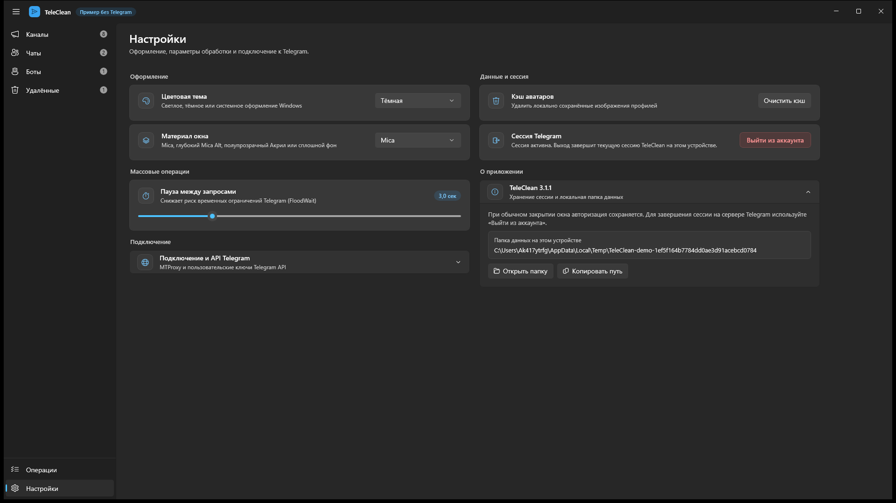
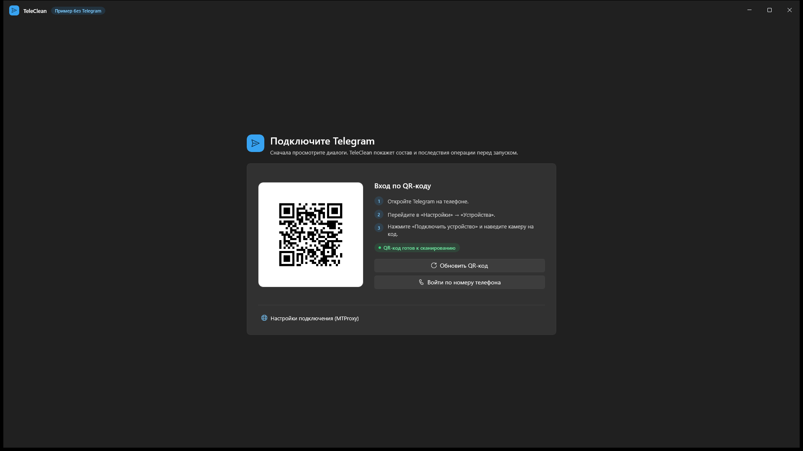

# TeleClean · WinUI

**TeleClean** — десктопное приложение для Windows (WinUI 3), которое помогает удобно просмотреть подписки Telegram (каналы, чаты, боты, удалённые аккаунты), отфильтровать нужные диалоги, проверить состав массовой операции перед запуском и безопасно выполнить очистку с защитой от ограничений API.

**[Скачать TeleClean для Windows x64](https://github.com/hiez1337/TeleClean/releases/latest/download/TeleClean-WinUI-win-x64.exe)** · [Релизы](https://github.com/hiez1337/TeleClean/releases/latest) · [Скриншоты](docs/screenshots/README.md) · [Сборки CI](https://github.com/hiez1337/TeleClean/actions?query=branch%3Awinui)

## Возможности

- **Разделение по категориям**: каналы, чаты и супергруппы, боты, диалоги с удалёнными аккаунтами.
- **Быстрый поиск и сравнение**: поиск по названию и `@имени` (`Ctrl+F`), фильтры (непрочитанные, малые группы/каналы), сортировка по колонкам (название, участники, непрочитанные, последняя активность).
- **Безопасное выполнение**: предварительный просмотр выбранных диалогов и последствий перед запуском, настраиваемая пауза между запросами, автоматическая обработка `FloodWait`, пауза и остановка в любой момент.
- **Подробный журнал**: отслеживание хода операции в реальном времени и копирование отчёта.
- **Гибкий вход и оформление**: вход по QR-коду или номеру телефона (с поддержкой облачного пароля 2FA и `MTProxy`), светлая/тёмная тема и выбор материала окна (`Mica`, `Mica Alt`, `Акрил`, `Сплошной`).

## Скриншоты (1920×1080)

### Список диалогов и выбор


### Выполнение массовой операции и журнал


### Настройки


### Вход в Telegram


## Первый запуск

1. Скачайте и запустите `TeleClean-WinUI-win-x64.exe`. Установка и отдельная загрузка .NET не требуются.
2. Подключите Telegram по QR-коду или номеру телефона. При необходимости настройте `MTProxy` прямо на экране входа.
   При следующих запусках TeleClean восстанавливает сохранённую сессию автоматически.
3. Выберите нужную категорию, отметьте диалоги и нажмите **Проверить выбор**. Окно подтверждения покажет состав и последствия операции, а ход выполнения отобразится в разделе **Операции**.

## Демо-режим (без подключения к Telegram)

Чтобы оценить интерфейс и работу списков на тестовых данных без входа в аккаунт, запустите из PowerShell рядом со скачанным файлом:

```powershell
.\TeleClean-WinUI-win-x64.exe --demo
```

Откроется вымышленный список диалогов во временном профиле: работают поиск, фильтрация, сортировка, выбор, подтверждение, запуск, пауза и остановка. Чтобы посмотреть экран входа с тестовым QR-кодом, используйте флаг `--demo-login`.

## Версия на Python

Отдельная реализация на Python / PySide6 поддерживается в ветке [`python`](https://github.com/hiez1337/TeleClean/tree/python) (релиз [v2.0.37](https://github.com/hiez1337/TeleClean/releases/tag/v2.0.37)).

## Сборка из исходников

Требуются Windows 10 (19041+) или Windows 11, .NET 8 SDK и Windows SDK. Зависимости восстанавливаются с NuGet.org.

```powershell
dotnet test src/TeleClean.Tests/TeleClean.Tests.csproj -c Release
dotnet build src/TeleClean.App/TeleClean.App.csproj -c Release -p:Platform=x64
.\src\TeleClean.App\bin\x64\Release\net8.0-windows10.0.19041.0\win-x64\TeleClean.App.exe
```

Публикация в один самодостаточный EXE (профиль `WinX64`):

```powershell
dotnet publish src/TeleClean.App/TeleClean.App.csproj -c Release -p:Platform=x64 -p:PublishProfile=WinX64 -p:DebugType=none --artifacts-path artifacts/single-file-build -o artifacts/publish
Copy-Item artifacts/publish/TeleClean.App.exe artifacts/TeleClean.exe
```

## Работа с диалогами

- **Навигация и поиск**: `Ctrl+F` переводит фокус в поиск, `F5` обновляет список. Клик по заголовкам колонок переключает сортировку, кнопка **Сбросить** очищает фильтры.
- **Адаптивная сетка**: в широком окне отображаются колонки участников, непрочитанных, даты активности и статуса; в узком окне сведения компактно переносятся под название. Контекстное меню строки (**Сведения о диалоге**) позволяет прочитать или скопировать длинное название и `@имя`.
- **Выбор элементов**: кнопка **Выбрать видимые** отмечает только отфильтрованные строки. При смене категории выбор сбрасывается, а при уточнении фильтра скрытые строки исключаются из выбора.
- **Последствия операций**: для выхода из закрытого канала или группы потребуется новое приглашение; удаление истории диалога с ботом очищает переписку, не блокируя бота.

## Локальные данные

- По умолчанию данные хранятся в `%APPDATA%/TeleClean` (поддерживается также переносной каталог `.teleclean`).
- Закрытие окна сохраняет сессию (`teleclean_v2.session`), а кнопка **Выйти из аккаунта** завершает её на сервере Telegram.
- Пользовательские API-ключи и `MTProxy` хранятся в `config.json` (либо задаются через переменные окружения `TELEGRAM_API_ID` и `TELEGRAM_API_HASH`).
- Журнал операций дописывается в `leave_history.jsonl` с сохранением совместимости с `leave_history.json`.
