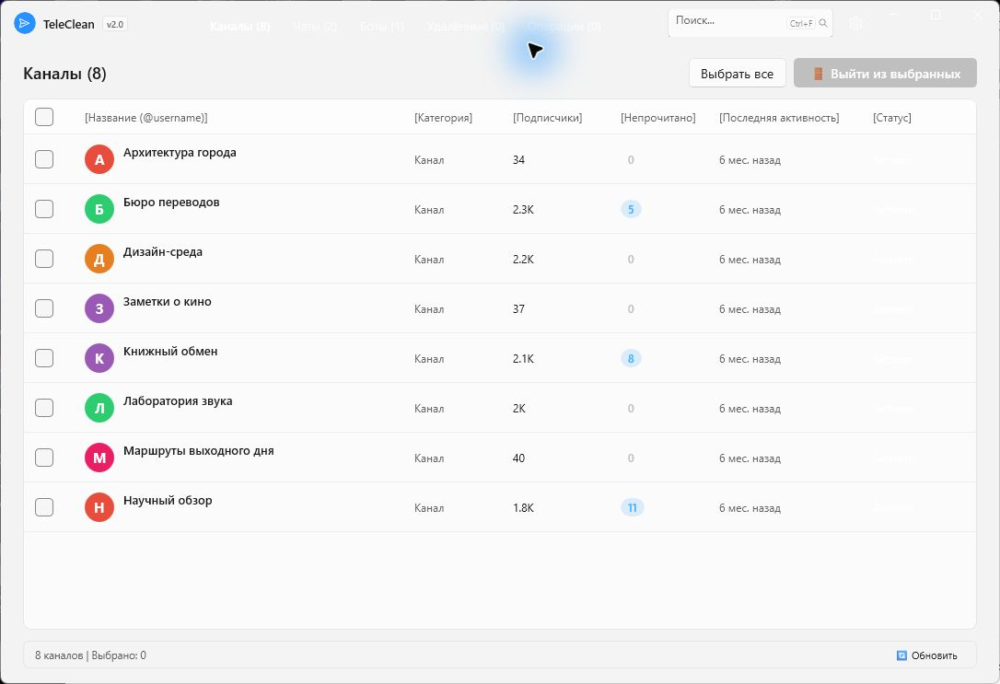
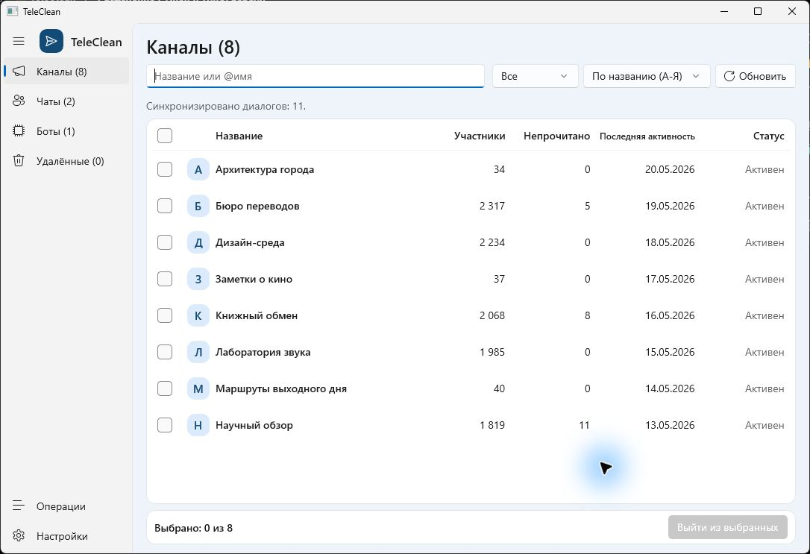
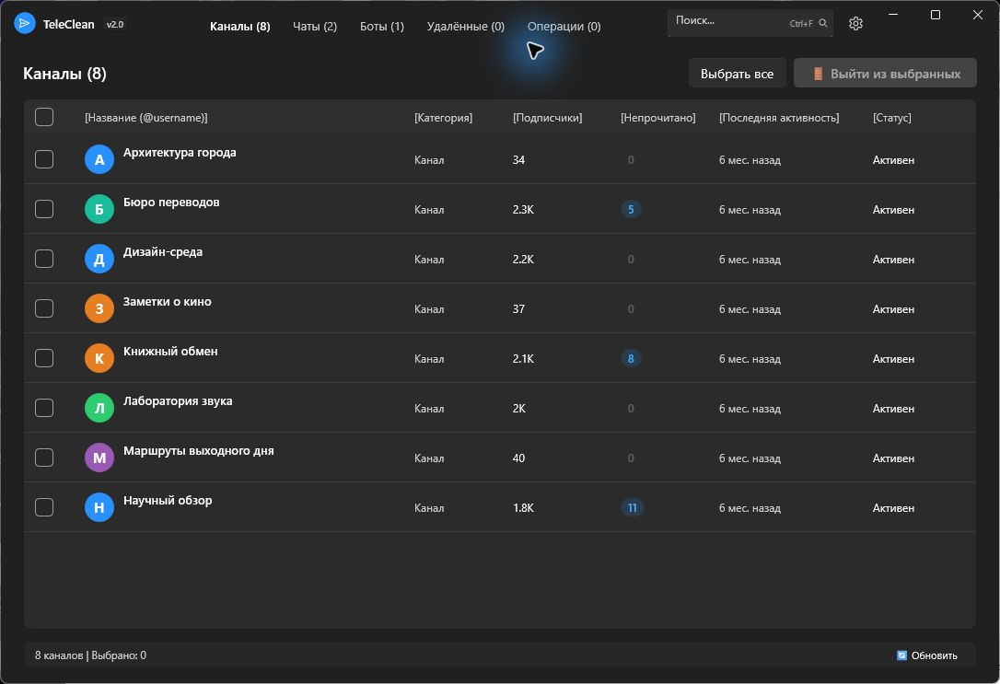
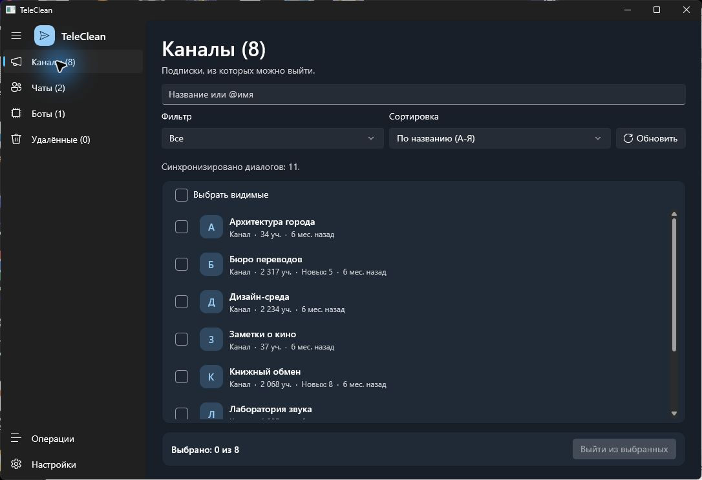
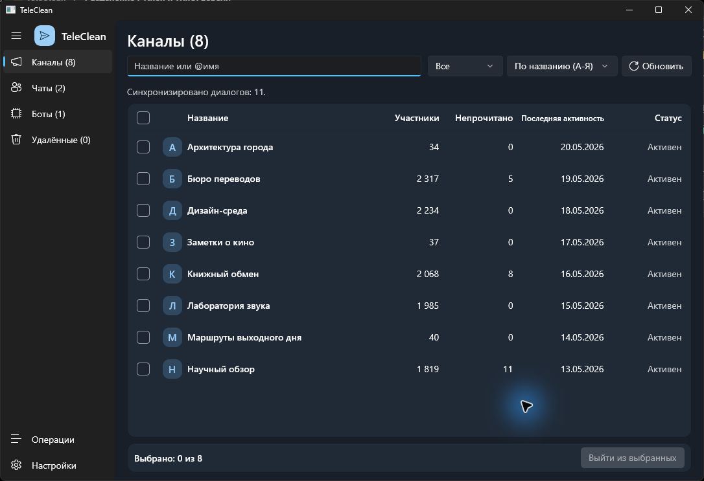
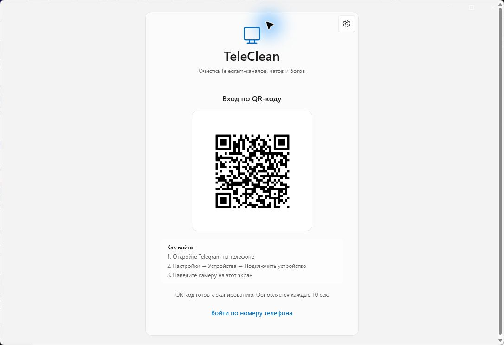
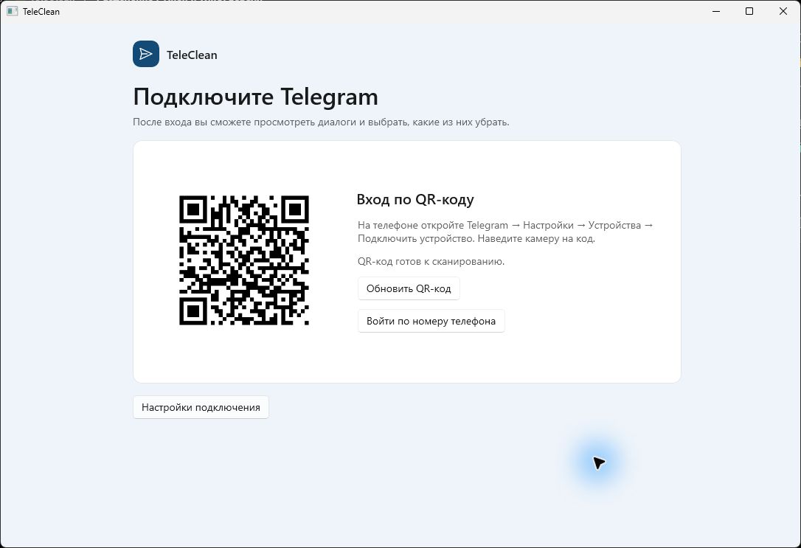
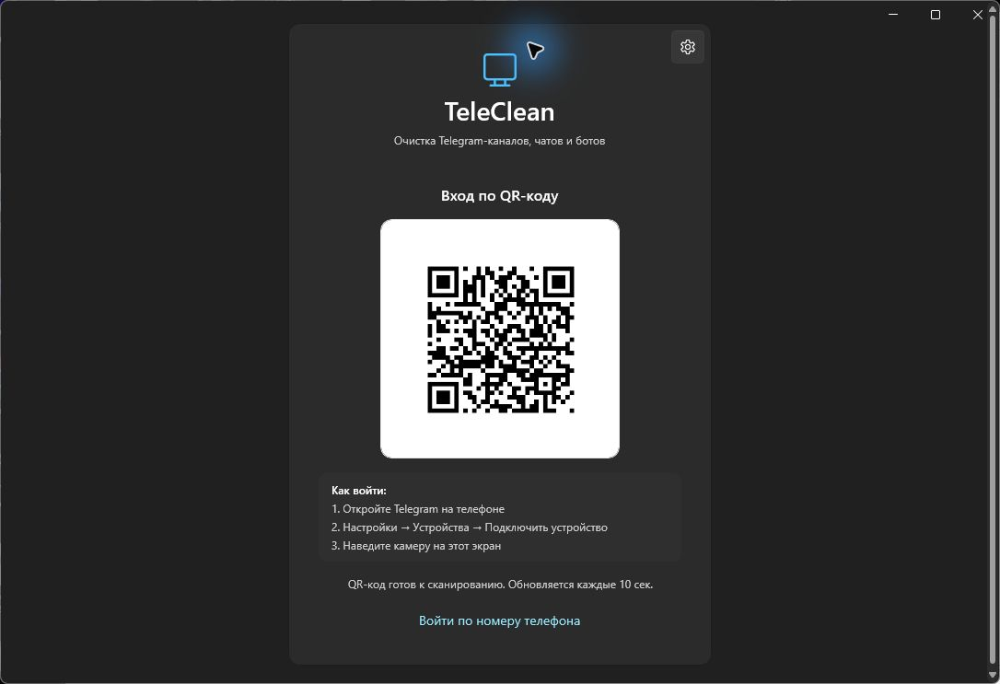
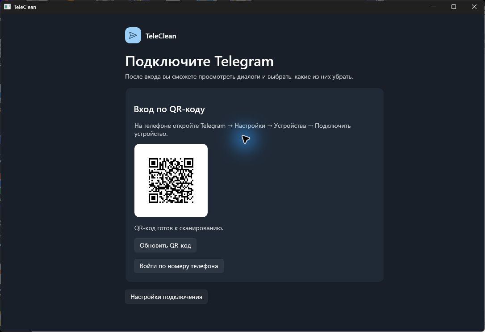
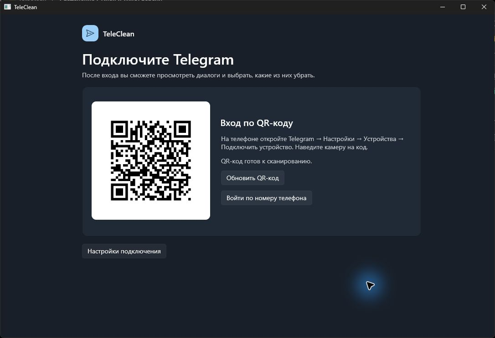

# WinUI до и после

Снимки сделаны из запущенных окон приложения. Исходная версия собрана с коммита `666bdb6`. Для обеих сборок использовались одинаковые вымышленные названия, временный профиль и офлайн-сервис. QR содержит тестовое значение.

| Экран и тема | До PR · `666bdb6` | Первый вариант · `c58b4d6` | Итог |
| --- | --- | --- | --- |
| Список · светлая |  |  |  |
| Список · тёмная |  |  |  |
| Вход · светлая |  |  |  |
| Вход · тёмная |  |  |  |

Окна снимались при 1100×750 и одинаковом системном масштабе. При захвате видимой области за вычетом границ Windows изображения имеют размер 1086×743. В исходном и итоговом списках полностью видны восемь каналов, в первом варианте PR — пять. В итоговой таблице числовые колонки выровнены вправо, дата указана явно. Размер области чёрных модулей тестового QR составляет 158×158, 100×100 и 174×174 пикселей соответственно в обеих темах.

При ширине 610 пикселей доступны поиск, фильтр, сортировка, выбор видимых строк и подтверждение операции. [Светлая тема](refined-compact-light.png) · [Тёмная тема](refined-compact-dark.png)

## Дополнительные экраны

- [Подтверждение выхода из выбранных каналов](after-confirm-light.png)
- [Итог прерванной очереди](after-operations-light.png)
- [Настройки в светлой теме](after-settings-light.png) и [в тёмной теме](after-settings-dark.png)
- [Компактный список в первом варианте PR](after-compact-light.png)
