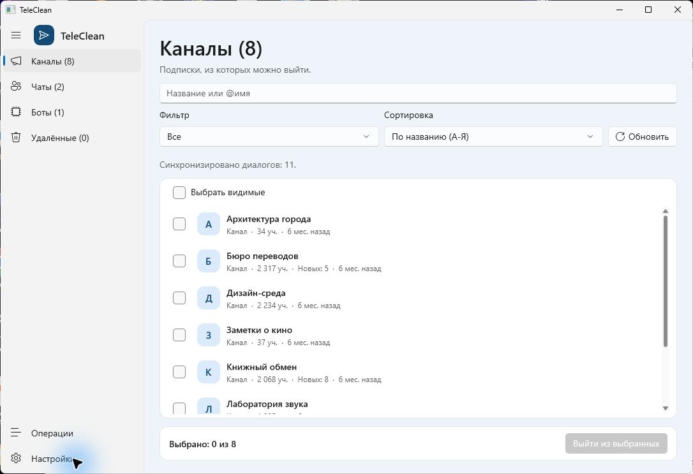
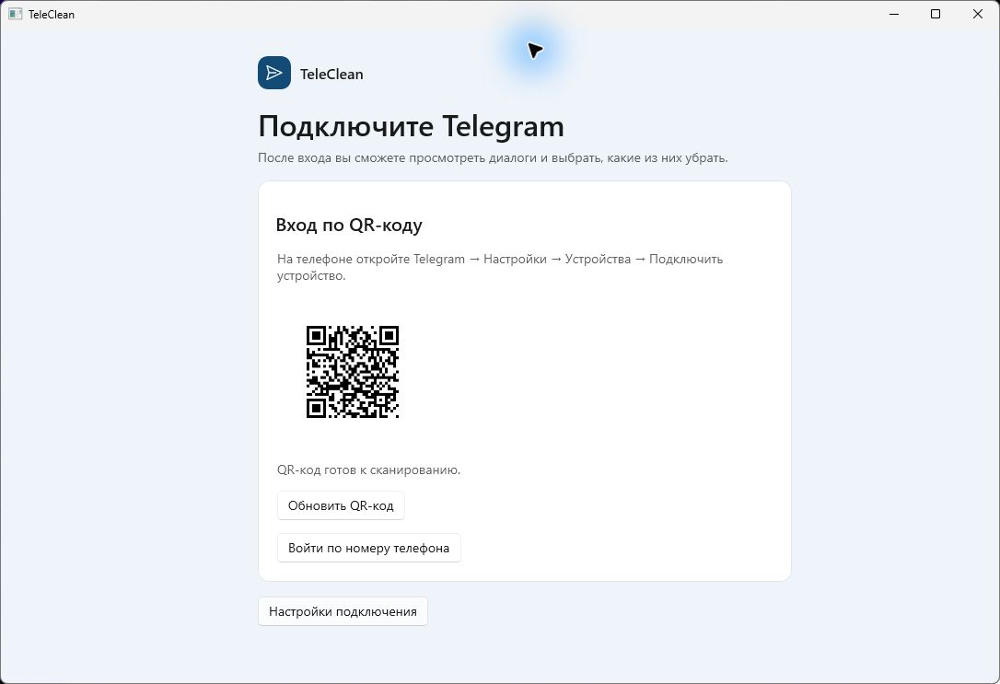

# WinUI до и после

Снимки сделаны из запущенных окон приложения. Исходная версия собрана с коммита `666bdb6`. Для обеих сборок использовались одинаковые вымышленные названия, временный профиль и офлайн-сервис. QR содержит тестовое значение.

| Экран и тема | До | После |
| --- | --- | --- |
| Список · светлая |  |  |
| Список · тёмная |  |  |
| Вход · светлая |  |  |
| Вход · тёмная |  |  |

В списке действия вынесены в отдельную нижнюю панель. Поиск, фильтр и сортировка расположены над строками. На экране входа инструкция предшествует QR-коду, а обновление кода и вход по телефону доступны рядом.

## Дополнительные экраны

- [Подтверждение выхода из выбранных каналов](after-confirm-light.png)
- [Итог прерванной очереди](after-operations-light.png)
- [Настройки в светлой теме](after-settings-light.png) и [в тёмной теме](after-settings-dark.png)
- [Список при ширине окна 610 пикселей](after-compact-light.png)
